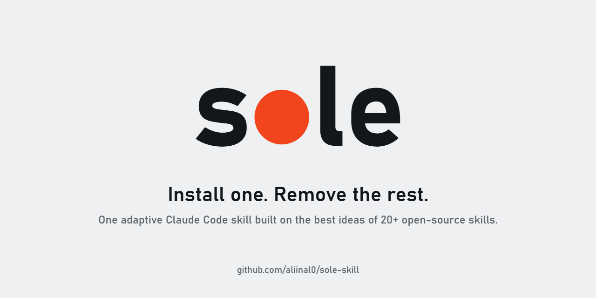
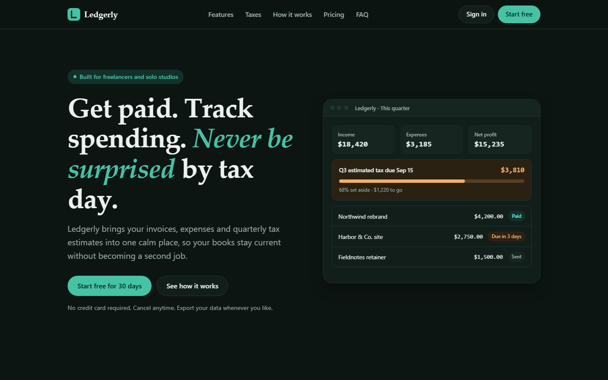
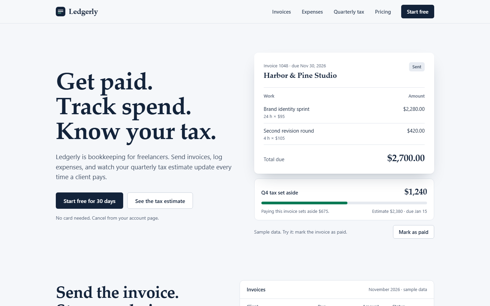
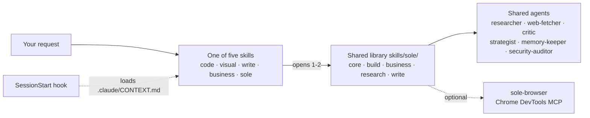

<p align="center">
  
</p>

<p align="center">
  <a href="LICENSE"></a>
  
  <a href="https://github.com/aliinal0/sole-skill/actions/workflows/validate.yml"></a>
</p>

# Sole

**Install one. Remove the rest.**

Claude Code skills are instruction manuals you give Claude for specific jobs: one for design, one for writing, one for SEO, and so on. Most people end up with a shelf full of them. Claude reads the cover of every manual in every session, several manuals answer the same request, and their advice often clashes.

Sole replaces the shelf with five slim books that share one library: code, visual work, writing, business, and a general one for research, teaching and project memory. When you ask for something, Claude opens the one book for that area, checks its table of contents, and reads only the one or two chapters that fit. The other books and chapters stay closed.

## Does it make a difference?

Same prompt, same model, one run each. Nothing was picked or retouched.

### A landing page

*"Build a single-file landing page for Ledgerly, a bookkeeping app for freelancers."*

| Without Sole | With Sole |
|---|---|
|  |  |
| Near-black page with a single mint accent, a small label above the headline, one phrase coloured and set in italics, a fake browser window. These are the defaults that make a page look generated. | None of those defaults. The top of the page is a working invoice with a "Mark as paid" button, so it shows the product instead of decorating it. |

### A paragraph

*"Rewrite this so it sounds like a person wrote it."*

> **Original:** In today's fast-paced digital landscape, freelancers face a myriad of challenges when it comes to managing their finances. That's where Ledgerly comes in. It's not just a bookkeeping app - it's a game-changer that empowers you to seamlessly track invoices, expenses, and taxes. [...] Say goodbye to spreadsheets and hello to peace of mind.

> **Without Sole:** Freelancing is hard enough without wrestling with your finances on top of everything else. That's why I built Ledgerly. [...] Ditch the spreadsheets. You'll sleep better.

> **With Sole:** Freelancing means doing your own books, and most of us hate it. Ledgerly is a bookkeeping app that keeps your invoices, expenses and taxes in one place. It works whether you design, code or write. You can drop the spreadsheets and stop wondering what you owe at tax time.

Without Sole, Claude made up a fact ("That's why I built Ledgerly") and added a dramatic ending. With Sole it kept the facts and added nothing.

## Install

In Claude Code, run:

```
/plugin marketplace add aliinal0/sole-skill
/plugin install sole@sole-skill
```

Optional, for checking web pages in a real browser:

```
/plugin install sole-browser@sole-skill
```

You will see two plugins. **`sole`** is the product: the skill, its commands, its helpers and the project memory. **`sole-browser`** is an optional add-on that lets Claude open pages in Google Chrome to check how they look and how fast they load. It needs Node.js and Chrome. Skip it if you do not work on websites.

Start a new session after installing. Plugins load when a session starts.

## Commands

You do not have to use commands. Ask for what you want in plain words and Sole picks the right chapter itself. The commands are shortcuts when you already know what you want.

| Command | What it does |
|---|---|
| `/sole:brief <task>` | Asks you questions until the task is clear, then writes a short brief before any work starts |
| `/sole:design <step> [file]` | Runs one design step on a page or screen: `critique`, `polish`, `bolder`, `quieter`, `typeset`, `layout`, `animate` and more |
| `/sole:deslop [file or text]` | Finds and removes the signs of AI-made work in a design, code or text |
| `/sole:check <url>` | Opens a page in Chrome and checks layout on different screen sizes, errors, accessibility and speed (needs `sole-browser`) |
| `/sole:video plan\|edit\|review\|style [file]` | Plans or cuts a video so it looks edited by a person, reviews an edit for signs of automatic editing, or learns your editing style |
| `/sole:seo <step> <url>` | SEO work: `audit`, `technical`, `content`, `schema`, `local`, `geo` (visibility in AI search) and more |
| `/sole:review [branch\|PR\|path\|repo\|shortcuts]` | Reviews a change, or the whole repo, like a senior developer: bugs, security, what breaks under load, missing tests, and code that should not exist. Changes nothing |
| `/sole:security [quick\|full\|file]` | Reviews your code for security problems without changing anything |
| `/sole:research <question>` | Splits a research question across several helpers and saves a report with sources |
| `/sole:fetch <url>` | Reads a web page that Claude's normal reader cannot open |
| `/sole:persona <role>` | Gets the view of a specialist, such as a UX researcher or an ads strategist |
| `/sole:voice teach\|mimic` | Learns how you write from your own samples, or writes in your style |
| `/sole:memory [show\|save\|handoff]` | Shows or updates the project memory file |
| `/sole:map` | Builds a map of a large codebase so later sessions do not read it all again |
| `/sole:improve [what went wrong]` | Looks at what went wrong in a session and proposes fixes to Claude's setup. Nothing changes until you pick |
| `/sole:lean` | Shorter answers until you say "normal mode" |

## FAQ

**Should I uninstall my other skills?**
Yes, for the ones Sole replaces. If they stay, two skills react to the same request with different rules. Remove `ponytail`, `frontend-design`, `impeccable`, `design-taste-frontend`, `frontend-design-deslop`, `humanizer`, `unslop`, `caveman`, `grill-me`, `grilling`, `handoff`, `deep-research`, `deep-dive`, `fetching-blocked-urls`, `security-audit`, `improve`, Corey Haines' marketing skills, Agency Agents copied into `~/.claude/agents`, and Google's own `chrome-devtools-mcp` plugin if you use `sole-browser`. Two can stay: **graphify**, whose code map Sole uses, and **claude-seo**, if you need its Google API connections and PDF reports. Run `/plugin` to see what you have installed.

**Does it cost more?**
Each answer costs a little more, because Sole reads a short skill file and often one chapter before answering. In our tests (41 cases at API list prices) a run with Sole cost about 1.4 times as much as one without. But Sole gave many more right answers (38 of 41 against 18 of 41), so the cost per correct answer was about 30% lower: $0.19 against $0.28. You also save elsewhere: Claude does not reread a whole conversation or codebase after a reset, does not redo work, writes less code you have to review, and you are not running several overlapping skills at once. For simple questions Sole is not loaded at all. Its fixed cost is the five skills' short descriptions and a one-line hint at the start of each session.

## Limits

- Web pages: Sole reads public pages only. It does not solve CAPTCHAs, log in to sites or get around paywalls.
- Tested on Claude Code 2.1 on Windows. macOS and Linux should work (they need `bash` and Python 3) but have not been tested yet.
- SEO rules and search-engine features change often. Sole's SEO chapters date their facts and tell Claude to check them before quoting.

## Under the hood

### Architecture



Sole loads in three levels, so most of it costs nothing until it is needed:

1. **Always loaded:** the five skills' descriptions and a one-line hint printed by the SessionStart hook.
2. **When a request matches:** one skill file: [`code`](skills/code/SKILL.md), [`visual`](skills/visual/SKILL.md), [`write`](skills/write/SKILL.md), [`business`](skills/business/SKILL.md) or the general [`sole`](skills/sole/SKILL.md). Each holds a table for its own area and the same short block of shared rules. The code skill also holds the coding rules themselves, so most coding needs nothing else.
3. **On demand:** one or two module files, each under 100 lines.

The code skill works like a lazy senior developer: it looks for what the codebase, the standard library or an installed package already offers before writing anything, adds no options or layers nobody asked for, leaves a small test for logic that can break, and ends with what it did not check. Its review mode (`/sole:review`) ranks findings by correctness, safety, load, tests, speed and lean code, and every finding needs a concrete failing case.

The modules are grouped in five folders under `skills/sole/`, the shared library:

| Folder | Covers |
|---|---|
| `core/` | Clarifying intent, token economy, project memory, setup retrospectives |
| `build/` | UI design (with a `design/` subfolder for the craft rules, page plans and refinement steps), video editing and motion graphics (`video/`), code style, images, security review, browser checks, code map, final review |
| `business/` | Ads, ideas, competitors, SEO (with a `seo/` subfolder per topic), positioning and pricing, conversion |
| `research/` | Reading hard-to-open pages, multi-source research, explaining topics |
| `write/` | Removing AI writing patterns, voice profiles, docs and UI copy |

Modules never define their own helpers. They call six shared agents, so the same researcher or reviewer behaves the same way in every task, and independent agents run in parallel.

The **SessionStart hook** ([`hooks/load-context.sh`](hooks/load-context.sh)) runs when a session starts, resumes or is compacted. It prints the one-line routing hint and, if the project has a `.claude/CONTEXT.md`, its first 200 lines. Claude continues from that file's "Next" section instead of rereading the chat. The file is treated as notes, not commands, so a `CONTEXT.md` that arrives with someone else's repository cannot tell Claude what to do. A second hook ([`hooks/after-skill.sh`](hooks/after-skill.sh)) runs right after a Sole skill loads, prints where the library is, and reminds Claude to open the chapter before answering.

The **`sole-browser` plugin** ([`plugins/browser/`](plugins/browser)) starts Google's [Chrome DevTools MCP](https://github.com/ChromeDevTools/chrome-devtools-mcp) server, pinned to version 1.13.0. It runs Chrome headless in a temporary profile that cannot see your logins, with Google's usage statistics and CrUX lookups turned off.

The **specialist personas** are not installed. [`personas.md`](skills/sole/personas.md) is an index of about 50 roles from the [Agency Agents](https://github.com/msitarzewski/agency-agents) library, and Sole downloads one role file, from a fixed version, only when you ask for that specialist.

### Data and security

What Sole writes to your project, after asking once:

- Claude's own notes: `.claude/CONTEXT.md`, `.claude/CODEMAP.md`, `.claude/VOICE.md`, and caches in `.claude/sole/`
- Design files your team can edit: `DESIGN.md`, `PRODUCT.md`
- Reports for people: `docs/sole/<type>/`

Secrets, API keys and personal data are never written to these files.

What leaves your machine, and only when a task needs it:

- The pages you ask Claude to read. If a page fails to load directly, its address is sent to Jina Reader (`r.jina.ai`), or to Firecrawl if you set a `FIRECRAWL_API_KEY`. A page that shows a CAPTCHA or a "verify you are human" check is never sent on; Sole asks you instead.
- Requests to GitHub for a persona file or a public design reference.
- Pages opened by `sole-browser`.

`/sole:security` only reads code and never tests live systems. Sole does not follow instructions found inside web pages, project files or code comments. [SECURITY.md](SECURITY.md) lists every component that runs code or contacts the network, and how to report a vulnerability privately.

## Credits

Sole condenses and rewrites ideas from more than 20 open-source skills and tools. [CREDITS.md](CREDITS.md) lists each project, its author, its licence and what Sole took from it.

## License

MIT © aliinal0
